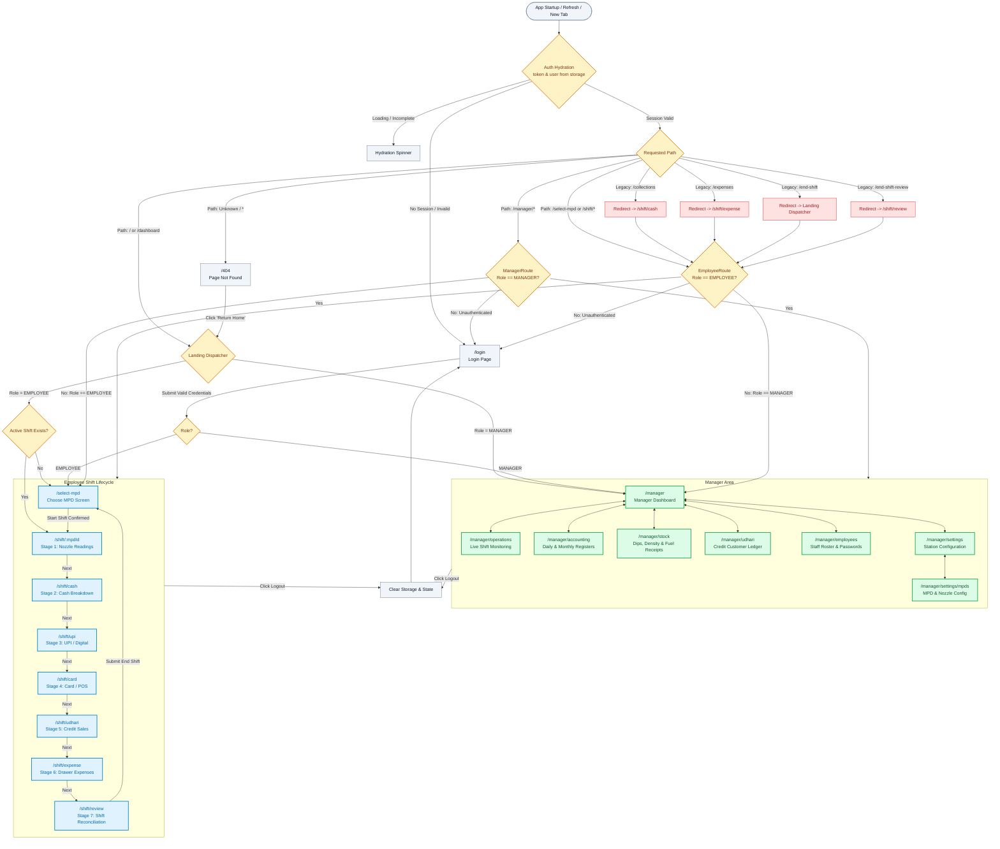

# ShobhaDamodar Petroleum — Route Inventory & Navigation Map

**Document Version:** 1.0.0  
**Last Updated:** October 2026  
**System:** React 19 + Ionic 9 (`@ionic/react-router` + `react-router-dom` v6)  
**Target Environments:** Web (Desktop & Mobile) and Capacitor Android Native Application  

---

## 1. Executive Summary & Root Cause Analysis

### Issue A: Manager Redirected to Employee MPD Selection ("Choose your MPD")
- **Reported Incident:** A manager logged in with manager credentials, refreshed or opened the application in a new browser tab, and landed on the employee-only "Choose your MPD" screen (`/select-mpd`). Clicking an MPD showed the backend rejection: *"Only employees can start shifts."*
- **Root Cause Identified:**
  1. **Missing Employee Role Guard:** In `frontend/src/app/routes/App.jsx`, manager routes were guarded with `<ManagerRoute>`, which verified `user?.role === "MANAGER"`. However, employee routes (such as `/select-mpd`, `/shift/:mpdId`, `/shift/*`, and `/dashboard`) were only guarded with `<ProtectedRoute>`. `<ProtectedRoute>` only verified that a JWT `token` was present; it never checked the user's role. Consequently, any authenticated manager was permitted to navigate directly into employee routes.
  2. **Unconditional Root Redirect to `/dashboard`:** In `App.jsx`, the root route was defined as:
     ```jsx
     <Route path="/" element={<Navigate to="/dashboard" replace />} />
     ```
     When a manager opened a new browser tab to the base URL (`/`), they were immediately redirected to `/dashboard`.
  3. **Transitional Shift Dispatcher in `/dashboard`:** The component rendered at `/dashboard` was `frontend/src/features/employee/shift/Dashboard.jsx`. In its `useEffect`, it invoked `getCurrentShift()` to find an active employee shift. Because a manager account never has an active dispensing shift in MongoDB (`Shift.findOne({ employeeId: req.user._id, status: "IN_PROGRESS" })`), `getCurrentShift()` returned `null`. Lines 44–46 of `Dashboard.jsx` then executed:
     ```javascript
     if (!response.data) {
       navigate('/select-mpd', { replace: true });
       return;
     }
     ```
     This redirected the manager directly to `/select-mpd`.
  4. **Unresolved Role Fallback:** In `ManagerRoute`, any user without `user?.role === "MANAGER"` was redirected to `/select-mpd`. If auth state was momentarily restoring without an explicit manager role, the router defaulted to the employee destination instead of waiting or validating the role.

### Issue B: `/dashboard` Displays Three Blank/Empty White Cards
- **Reported Incident:** Observing `https://shobhadamodarpetroleum.onrender.com/dashboard` showed "Hello, Uday!" with the date, followed by three large, empty white cards.
- **Root Cause Identified:**
  1. **Abandoned Skeleton Loading State:** In `features/employee/shift/Dashboard.jsx`, lines 70–75 contained three pulsing placeholder `div` elements representing loading cards:
     ```jsx
     {loading ? (
       <div className="mt-6 space-y-4">
         <div className="h-[190px] animate-pulse rounded-[24px] bg-white" />
         <div className="h-[145px] animate-pulse rounded-[24px] bg-white" />
         <div className="h-[155px] animate-pulse rounded-[24px] bg-white" />
       </div>
     ) : ...}
     ```
  2. **Missing State Setter & Architectural Drift:** `Dashboard.jsx` was originally a prototype shift dashboard created during Phase 1. Later, when the dedicated 7-stage staged shift workflow (`/shift/:mpdId` through `/shift/review`) and `SelectMpd` were built, `Dashboard.jsx` was gutted to act merely as a redirector. The state declaration was left as `const [currentShift] = useState(null);` without any setter function. `currentShift` was never populated, so the card content could never render.
  3. **Network Latency & Cold Starts on Render:** When visiting `https://shobhadamodarpetroleum.onrender.com/dashboard`, while the backend was cold-starting or querying MongoDB for `getCurrentShift()`, `loading` remained `true`. The browser rendered the greeting header ("Hello, Uday!") and remained stuck displaying the three large blank white cards until the network request resolved (after which it bounced the user to `/select-mpd`).
  4. **Competing Dashboard Confusion:** The genuine, comprehensive manager dashboard is located at `/manager` (`features/manager/ManagerDashboard.jsx`). The route `/dashboard` was an obsolete artifact that should never have served as the default landing route or an un-redirected entry point.

---

## 2. Complete Route Inventory

| Route | Page/component | Access | Authentication | Entry points | Intended behaviour | Status | Action |
|---|---|---|---|---|---|---|---|
| `/login` | `Login` (`features/auth/Login.jsx`) | Public | None (Redirects if already authenticated) | Initial load when unauthenticated, 401 response interceptor, header logout button | Render branded login card with Employee ID and Password inputs, language switcher, and submission handler | Active | Keep. Guard against rendering for already authenticated users. |
| `/` | `LandingRedirect` | Shared | Role-aware landing dispatcher | Application launch, domain root entry, browser new tab, 404 recovery "Return Home" | Evaluates session: unauthenticated -> `/login`; `MANAGER` -> `/manager`; `EMPLOYEE` -> checks shift -> `/shift/:mpdId` (if active) or `/select-mpd` | Broken (was hardcoded redirect to `/dashboard`) | Fix. Replace hardcoded redirect with role-aware dispatcher. |
| `/dashboard` | `LandingRedirect` | Shared | Required session | Direct URL entry, legacy bookmarks, old links | Legacy redirect: routes managers to `/manager`, and employees to their active shift or `/select-mpd` | Broken / Obsolete entrypoint | Redirect. Point to role-specific landing page via `LandingRedirect`. |
| `/manager` | `ManagerDashboard` (`features/manager/ManagerDashboard.jsx`) | Manager-only | `ManagerRoute` (`token && user.role === "MANAGER"`) | Manager login, session restore, `ManagerBottomNav` Home, `LandingRedirect` | Full station management hub: KPI cards, date selector, quick actions to Operations, Accounting, Stock, Udhari, Employees, Settings | Active | Keep. Canonical manager landing page. |
| `/manager/operations` | `Operations` (`features/manager/Operations.jsx`) | Manager-only | `ManagerRoute` (`token && user.role === "MANAGER"`) | `ManagerBottomNav`, `ManagerDashboard` card, `Employees.jsx` link | Live shift monitoring across all station MPDs, assigned attendants, force-end shift modal, past shift archive | Active | Keep. |
| `/manager/accounting` | `Accounting` (`features/manager/Accounting.jsx`) | Manager-only | `ManagerRoute` (`token && user.role === "MANAGER"`) | `ManagerBottomNav`, `ManagerDashboard` card & Today button, `Operations.jsx` link | Daily & monthly sales figures, payment breakdowns (Cash, UPI, Card, Udhari), expense ledger, shift settlement audits | Active | Keep. |
| `/manager/stock` | `Stock` (`features/manager/Stock.jsx`) | Manager-only | `ManagerRoute` (`token && user.role === "MANAGER"`) | `ManagerBottomNav`, `ManagerDashboard` card, `Settings.jsx` link | Tank calibration dip charts, ASTM 53B density conversion, fuel receipts (MS & HSD), daily variation register, fuel rate configuration | Active | Keep. |
| `/manager/udhari` | `Udhari` (`features/manager/Udhari.jsx`) | Manager-only | `ManagerRoute` (`token && user.role === "MANAGER"`) | `ManagerBottomNav`, `ManagerDashboard` card | Credit customer accounts, outstanding balances, payment settlements, transaction ledger | Active | Keep. |
| `/manager/employees` | `Employees` (`features/manager/Employees.jsx`) | Manager-only | `ManagerRoute` (`token && user.role === "MANAGER"`) | `ManagerBottomNav`, `ManagerDashboard` card, `Operations.jsx` link | Staff management: employee directory, account status (ACTIVE/SUSPENDED), password reset dialog, profile audit logs | Active | Keep. |
| `/manager/settings` | `Settings` (`features/manager/Settings.jsx`) | Manager-only | `ManagerRoute` (`token && user.role === "MANAGER"`) | `ManagerDashboard` card, `ManagerHeader` top-right menu | Station configuration, MPD setup navigation, language preferences, software metadata | Active | Keep. |
| `/manager/settings/mpds` | `MpdConfig` (`features/manager/MpdConfig.jsx`) | Manager-only | `ManagerRoute` (`token && user.role === "MANAGER"`) | `Settings.jsx` MPD card button | Add/edit MPD dispensing units, configure nozzle fuel mappings, inspect live shift locks | Active | Keep. |
| `/select-mpd` | `SelectMpd` (`features/employee/shift/SelectMpd.jsx`) | Employee-only | `EmployeeRoute` (`token && user.role === "EMPLOYEE"`) | Employee login (no active shift), `LandingRedirect`, end-shift completion | Displays available MPDs. If employee already has an active shift, auto-redirects to `/shift/:mpdId`. Allows selecting available MPD and starting shift. | Active (Previously missing role guard) | Fix. Guard with `EmployeeRoute` so managers are redirected to `/manager`. |
| `/shift/:mpdId` | `EndShift` (`features/employee/shift/EndShift.jsx`) | Employee-only | `EmployeeRoute` (`token && user.role === "EMPLOYEE"`) | Start shift completion, `LandingRedirect` resume, `WorkflowStatusBar` nozzle button | Stage 1 (Nozzle): Closing meter readings entry for assigned MPD, live sales and dispensed volume calculations | Active | Fix. Guard with `EmployeeRoute`. |
| `/shift/cash` | `CashCollectionPage` (`features/employee/collections/CashCollectionPage.jsx`) | Employee-only | `EmployeeRoute` (`token && user.role === "EMPLOYEE"`) | `EndShift.jsx` Next button, `WorkflowStatusBar` cash button, card stage back button | Stage 2 (Cash): Physical cash denomination entry (500, 200, 100, 50, 20, 10, coins) | Active | Fix. Guard with `EmployeeRoute`. |
| `/shift/upi` | `UpiCollectionPage` (`features/employee/collections/UpiCollectionPage.jsx`) | Employee-only | `EmployeeRoute` (`token && user.role === "EMPLOYEE"`) | Cash stage Next button, `WorkflowStatusBar` upi button, card stage back button | Stage 3 (UPI): PhonePe / digital QR collection entry with first & last transaction times | Active | Fix. Guard with `EmployeeRoute`. |
| `/shift/card` | `CardCollectionPage` (`features/employee/collections/CardCollectionPage.jsx`) | Employee-only | `EmployeeRoute` (`token && user.role === "EMPLOYEE"`) | UPI stage Next button, `WorkflowStatusBar` card button, udhari stage back button | Stage 4 (Card): POS / swipe terminal collection entries with timestamped receipts | Active | Fix. Guard with `EmployeeRoute`. |
| `/shift/udhari` | `UdhariCollectionPage` (`features/employee/collections/UdhariCollectionPage.jsx`) | Employee-only | `EmployeeRoute` (`token && user.role === "EMPLOYEE"`) | Card stage Next button, `WorkflowStatusBar` udhari button, expense stage back button | Stage 5 (Udhari): Credit sale recording with customer selection, vehicle number, fuel type, volume, and rate | Active | Fix. Guard with `EmployeeRoute`. |
| `/shift/expense` | `Expenses` (`features/employee/expenses/Expenses.jsx`) | Employee-only | `EmployeeRoute` (`token && user.role === "EMPLOYEE"`) | Udhari stage Next button, `WorkflowStatusBar` expense button, review stage back button | Stage 6 (Expense): Log shift cash operational expenses paid from register with reason and receipt note | Active | Fix. Guard with `EmployeeRoute`. |
| `/shift/review` | `EndShiftReview` (`features/employee/review/EndShiftReview.jsx`) | Employee-only | `EmployeeRoute` (`token && user.role === "EMPLOYEE"`) | Expense stage Next button, `WorkflowStatusBar` review button | Stage 7 (Review): Reconciliation calculation (Dispensed Sale vs Collections + Expenses), difference status (MATCHED/SHORT/EXCESS), and finalize shift submission | Active | Fix. Guard with `EmployeeRoute`. |
| `/collections` | `Collections` (`features/employee/collections/Collections.jsx`) | Employee-only | `EmployeeRoute` | Legacy Phase 1 links/bookmarks | Monolithic single-page collections form superseded by the 7-stage staged flow | Legacy duplicate | Redirect. Point legacy visits to `/shift/cash` under `EmployeeRoute`. |
| `/expenses` | `Expenses` (`features/employee/expenses/Expenses.jsx`) | Employee-only | `EmployeeRoute` | Legacy Phase 1 links/bookmarks | Standalone expense route superseded by `/shift/expense` | Legacy alias | Redirect. Point legacy visits to `/shift/expense` under `EmployeeRoute`. |
| `/end-shift` | `EndShift` (`features/employee/shift/EndShift.jsx`) | Employee-only | `EmployeeRoute` | Legacy Phase 1 links/bookmarks | Alias for nozzle readings stage superseded by `/shift/:mpdId` | Legacy alias | Redirect. Point legacy visits to active shift or `/select-mpd` under `EmployeeRoute`. |
| `/end-shift-review` | `EndShiftReview` (`features/employee/review/EndShiftReview.jsx`) | Employee-only | `EmployeeRoute` | Legacy Phase 1 links/bookmarks | Alias for review stage superseded by `/shift/review` | Legacy alias | Redirect. Point legacy visits to `/shift/review` under `EmployeeRoute`. |
| `*` | `NotFound` (`features/common/NotFound.jsx`) | Public / Shared | None required | Any unregistered or mistyped path | Branded 404 screen with friendly explanation and "Return to Home" button that triggers role-aware redirection | Missing | Implement. Eliminates blank screens and redirect loops on invalid paths. |

---

## 3. Visual Navigation Flowchart

The following Mermaid diagram maps the complete, authentic routing topology of the application, derived directly from repository route definitions, context providers, and guard components.



---

## 4. Manager vs. Employee Separation Policy

### Manager Routing Rules
1. **Target Landing Destination:** After login, page refresh, or opening a new browser tab, every manager lands on `/manager`.
2. **Access Protection:** Every `/manager/*` route requires a valid JWT token and `user.role === "MANAGER"`. Any attempt by an employee to access a `/manager/*` route immediately redirects to the employee workflow (`/select-mpd`).
3. **Strict Exclusion from Employee Shift Flows:** A manager account must **never** be admitted to `/select-mpd` or any `/shift/*` route. If a manager enters an employee route, `EmployeeRoute` immediately intercepts and bounces them to `/manager`.
4. **Backend Enforcement:** The backend prohibits managers from calling `POST /api/shifts/start` (returning HTTP 403 `FORBIDDEN`: *"Only employees can start shifts."*). The frontend guards prevent managers from ever seeing or reaching the button that calls this endpoint.

### Employee Routing Rules
1. **Target Landing Destination:**
   - If the employee has an active (`IN_PROGRESS`) shift: `/shift/:mpdId` (or current stage).
   - If the employee has no active shift: `/select-mpd`.
2. **Access Protection:** All employee operational screens (`/select-mpd`, `/shift/*`) require a valid JWT token and `user.role === "EMPLOYEE"`.
3. **Strict Exclusion from Manager Controls:** An employee must **never** be permitted to view or modify manager dashboards, financial registers, stock dip charts, staff rosters, or settings. Any attempt to reach `/manager/*` redirects to `/select-mpd`.

---

## 5. Authentication Restoration & Hydration Strategy

1. **Synchronous Initialization with Error Handling:** In `AuthContext.jsx`, initialize `token` and `user` synchronously from `localStorage` or `sessionStorage` within a `try/catch` block to eliminate blank renders or syntax crash on malformed JSON.
2. **Hydration Loading Guard:** Introduce `isLoading` during any asynchronous session hydration or verification. Do not redirect before authentication state is fully known.
3. **Unresolved Role Handling:** If a token exists but `user.role` is null or invalid, the session is treated as corrupted/invalid. The application clears storage and redirects to `/login` rather than defaulting to the employee role.
4. **401 Response Refresh Lifecycle:** As managed in `services/api.js`, on 401 Unauthorized, an automatic call to `/auth/refresh` attempts to renew the access token using the stored `refreshToken`. If refresh succeeds, the queued request retries transparently. If refresh fails, storage is cleared and the browser cleanly navigates to `/login`.
